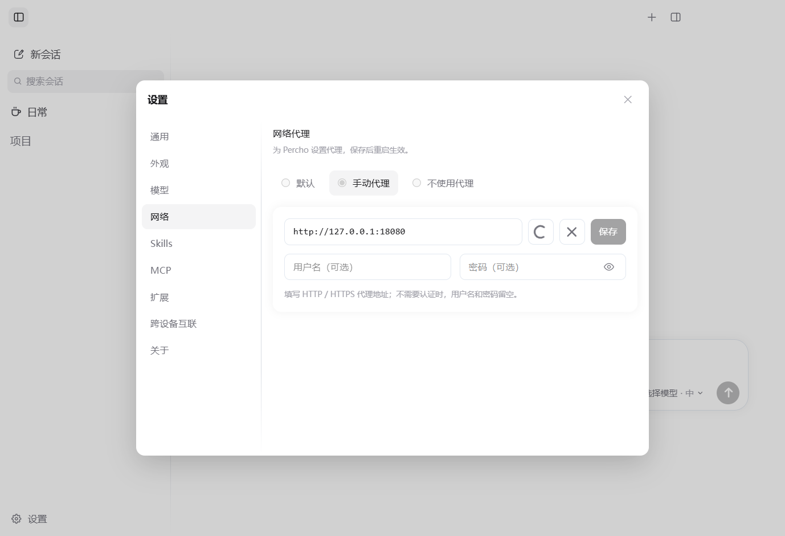
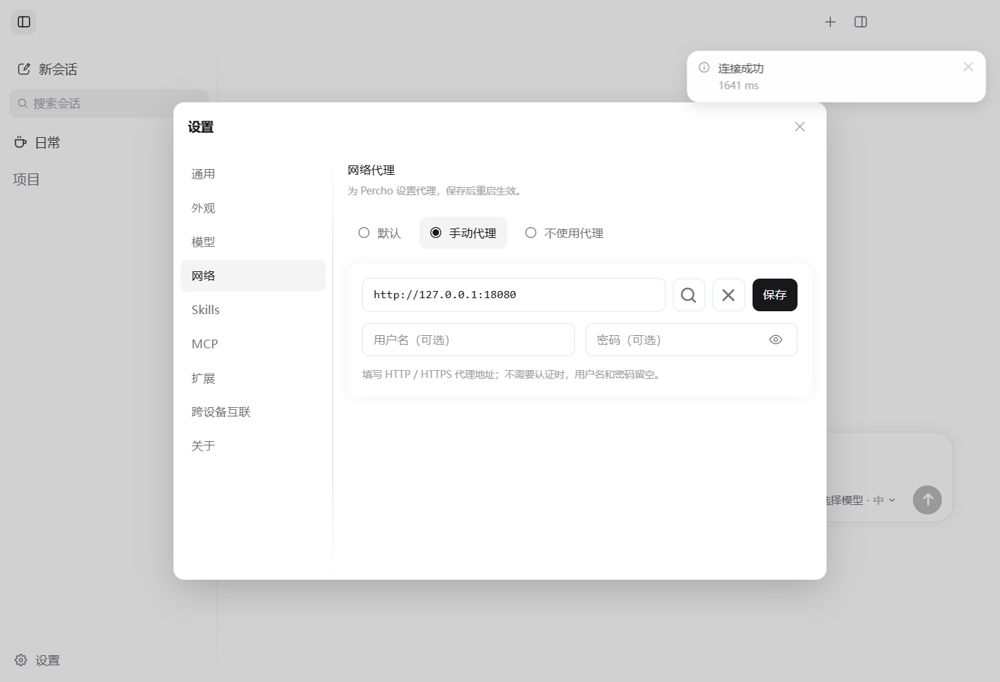

# 网络代理设置

在 **设置 → 网络** 中选择连接方式，保存后完全退出并重新打开 Percho。保存不会立即切换连接，也不会中断当前任务。

## 界面截图

测试连接时显示加载图标：



连接结果通过已有浮动提示显示：



## 界面操作

- 连接方式简化为“默认 / 手动代理 / 不使用代理”，界面不显示 Node、Electron 等实现术语。
- 手动代理第一行为代理地址、测试连接、清除、保存；第二行为可选用户名和密码。密码默认隐藏，可切换显示。
- 测试连接使用当前尚未保存的输入，通过代理请求 Google 的连通性检测地址，显示成功及耗时、认证失败或超时。不保存配置、不切换正在使用的连接，也不会调用付费模型。
- 测试期间仅将放大镜替换为同尺寸的加载图标，整个表单不变淡。测试结果复用右上角浮动提示，约 4.5 秒后自动消失，不在面板底部占用一行。
- 清除仅清空表单，点击保存后停用手动代理，重启生效。
- 不再显示“不走代理的地址”输入框；从界面保存手动代理后，应用联网统一使用此代理。历史配置中的绕过项仍可读取。
- 代理密码由系统凭据服务加密后保存在配置中，不能跨机器直接迁移；安全存储不可用时拒绝保存密码。
- 已保存的密码无法解密时，应用仍可启动，网络页面会提示重新填写；读取时保留原配置文件。

## 三种连接方式

| 方式 | Node 模型请求 | Electron 网络请求 |
|---|---|---|
| 沿用环境变量（默认） | 读取 `HTTP_PROXY`、`HTTPS_PROXY`、`NO_PROXY`；同名小写变量优先 | 使用系统代理 |
| 手动代理 | HTTP、HTTPS 共用填写的代理地址 | 使用相同代理与绕过列表 |
| 直连 | 忽略代理环境变量，重建直连连接器 | 忽略系统代理 |

Node 的环境变量模式不会自动读取 Windows 系统代理。只打开系统代理而没有设置环境变量时，Gemini 等 Node SDK 的请求仍可能直连。手动模式不依赖额外启动脚本。

手动模式会给 Percho 进程设置大小写一致的代理环境变量，覆盖继承的旧代理值；直连模式会清除这些变量。不会修改操作系统的代理设置或持久环境变量。后续启动的子进程能继承这些变量，但是否使用代理取决于子程序本身。

## 手动代理示例

代理地址填本地代理软件的 **HTTP 或 Mixed 端口**，例如：

```text
http://127.0.0.1:7897
```

这是网络代理的地址，模型服务商的 Base URL 与 API Key 仍在 **设置 → 模型** 中配置。

- 支持 `http://`、`https://` 代理与可选的用户名、密码认证；认证信息单独填写。暂不支持 SOCKS、PAC、URL 内的用户名和密码。
- 不要填写模型 API 地址、路径、查询参数或片段。

## 历史绕过配置

界面已移除绕过列表输入框。历史 `network.json` 中的 `noProxy` 字段仍可读取，保存界面中的手动代理时会清空该字段。

- `noProxy` 接受逗号分隔的域名或 IP，例如 `localhost,127.0.0.1,.example.com`，也可加端口。域名同时匹配其子域名。
- `*` 表示全部直连；暂不支持 CIDR、协议前缀和任意位置的通配符。
- 绕过列表为空时，手动模式下本机地址也使用代理。

## 配置与实现

配置存放在 Electron `userData/network.json`，与 Pi CLI 的 `~/.pi/agent` 配置分开；开发和预览实例使用隔离的 `-dev` 目录。缺失文件时默认沿用环境变量。文件损坏时启动回退默认值，保存拒绝覆盖损坏文件，请先备份并修复文件。

启动顺序是：读取网络配置 → 设置 Node 全局 fetch dispatcher、HTTP/HTTPS agents 与 Electron session → 初始化 PiBackend 和自动更新。这样 Gemini 的 Node 请求也能使用代理，仅调用 Electron `session.setProxy()` 无法覆盖这条请求路径。

Node fetch 使用显式声明的 `undici` 依赖，HTTP/HTTPS agents 使用项目当前 Electron 43 内置 Node 24 的 `proxyEnv`。不改变项目开发环境的 Node.js 22.19 最低要求。SDK 自行指定 dispatcher / agent、第三方扩展自行联网或外部浏览器中的 OAuth 页面不保证遵循此设置。
